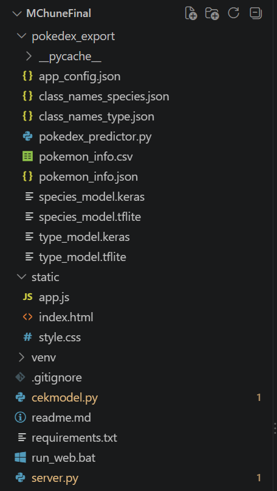

install dulu
winget install -e --id Python.Python.3.12

py -3.12 -m venv venv
venv\Scripts\activate
pip install -r requirements.txt

buat run 
python server.py

struktur

kalo mau keluar dari venv jalanin

deactivate
